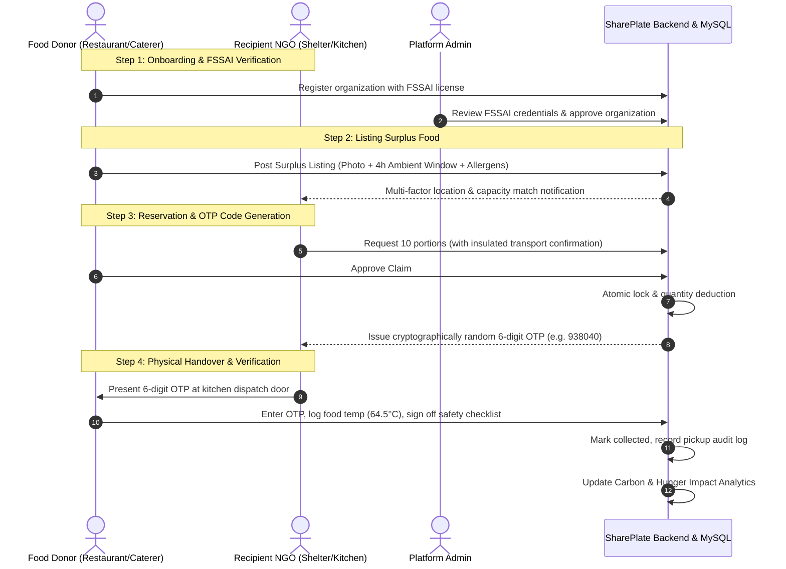

# SharePlate — Surplus Food Rescue Platform

> **"Good food deserves another destination."**

SharePlate is a production-grade surplus food rescue platform connecting verified food donors (commercial caterers, banquet halls, restaurants, hotels, bakeries) with frontline recipient charities (NGOs, shelters, community kitchens, food banks) and municipal public health administrators.

The platform is designed in accordance with the statutory provisions of the **Food Safety and Standards (Recovery and Distribution of Surplus Food) Regulations, 2019** under the Food Safety and Standards Authority of India (**FSSAI**).

---

## 🌟 Key Platform Features

1. **FSSAI Food Safety Compliance Engine**
   - **4-Hour Ambient Window**: Automatically enforces collection deadlines within 4 hours of preparation for cooked meals held at room temperature.
   - **Temperature Chain Monitoring**: Requires target storage temperatures and records physical temperatures during collection (Hot Holding $>60^\circ\text{C}$, Refrigerated $<5^\circ\text{C}$).
   - **Mandatory Allergen Disclosures**: Requires disclosure of the 10 major allergen classes before listings can be published.
   - **Pre-Collection & Handover Safety Checklists**: Recipient NGOs and donors must digitally certify container hygiene, absence of spoilage signs, and packaging integrity.
   - **Safety Incident Escalation**: Immediate administrative suspension and investigation queue for non-compliant listings.

2. **Atomic Quantity Reservations & 6-Digit Handover OTP**
   - Concurrency-safe partial or full portion claims using MySQL row-level locking (`SELECT ... FOR UPDATE`).
   - Generates cryptographically secure, random 6-digit OTP codes presented by the recipient collector and verified by donor staff at physical handover.
   - Complete chain of custody audit logging with IP tracking.

3. **Turn-by-Turn Rescue Route & Spatial Navigation Engine**
   - **Interactive Route Mapping**: Real-time road routing, polyline visualization, distance, and transit time between frontline charities and donor kitchens.
   - **Multi-Modal Transit Dispatch**: Supports Cargo Van, Insulated Scooter/Two-Wheeler, and Walking modes.
   - **FSSAI Ambient Transit Safe Window Check**: Automatically calculates whether travel and handover can be completed within the 4-hour statutory ambient food safety limit.
   - **Spatial Discovery & Geocoding**: Search Bangalore neighborhoods (Indiranagar, Koramangala, Whitefield, etc.) with radius ring filtering and GPS beacon.

4. **Server-Side AI Assistant with Offline Heuristic Fallback**
   - **Food Photo Assistant**: Analyzes uploaded photos to recommend category, draft descriptions, and visual allergen tags (Gemini Vision / OpenAI Vision adapter).
   - **Listing Assistant**: Auto-formats preparation and container logistics instructions.
   - **Explainable Matcher**: Explains why specific donations suit a recipient charity's capacity and distance.
   - *Deterministic Fallback*: Seamlessly falls back to local regex and rule-based heuristics when API keys or network are unavailable.
   - *Safety Guardrail*: AI recommendations require human donor sign-off and never make automated food safety approvals.

5. **Audited Carbon & Hunger Impact Analytics**
   - Real-time Recharts visualization tracking portions rescued, kilograms diverted, and metric tons of $\text{CO}_2\text{e}$ averted from landfill methane decomposition.
   - Documented conversion formulas: $0.42\text{ kg/portion}$ and $2.5\text{ kg }\text{CO}_2\text{e}/\text{kg food}$.

---

## 🛠️ Technology Stack

| Layer | Technologies |
| :--- | :--- |
| **Frontend** | React 19, TypeScript, Vite, Tailwind CSS v4, React Router 7, Axios, React Hook Form, Zod, Recharts, Leaflet, React-Leaflet, React Hot Toast, Lucide Icons |
| **Backend** | Python 3.12+, Flask 3.1, Flask-SQLAlchemy, Flask-Migrate, Flask-JWT-Extended, Flask-CORS, Flask-Marshmallow, PyMySQL, Bcrypt |
| **Database** | MySQL 8.0+ (Transactions, Foreign Keys, Row-Level Locking, READ COMMITTED Isolation) |
| **Testing** | Pytest (Backend API & Concurrency), Vitest & React Testing Library (Frontend UI & Auth), JSDOM |

---

## 📁 Directory Architecture

```
SharePlate Pro/
├── backend/
│   ├── app.py                      # Flask Application Factory & Blueprints
│   ├── config.py                   # Environment-based configuration (Dev, Test, Prod)
│   ├── extensions.py               # db, jwt, migrate, cors, ma
│   ├── models/                     # Normalized SQLAlchemy models
│   │   ├── user.py                 # Users & RBAC (DONOR, RECEIVER, ADMIN)
│   │   ├── organization.py         # FSSAI registration & verification status
│   │   ├── donation.py             # Food listings, safety specs, portion meters
│   │   ├── donation_request.py     # Reservations, status machine & 6-digit OTP
│   │   ├── pickup.py               # Physical handover logs & temperature
│   │   ├── notification.py         # Notification center
│   │   ├── safety_report.py        # Food safety complaints & investigations
│   │   └── audit_log.py            # Security & handover audit trail
│   ├── routes/                     # Versioned REST API (/api/v1)
│   │   ├── auth_routes.py          # Register, Login, Me, Profile
│   │   ├── organization_routes.py  # Org profiles, admin verification queue
│   │   ├── donation_routes.py      # CRUD, discover, /my listings, photo upload
│   │   ├── request_routes.py       # Atomic claim, approve, cancel, decline
│   │   ├── pickup_routes.py        # Physical OTP handover verification
│   │   ├── analytics_routes.py     # Carbon & hunger impact metrics
│   │   ├── safety_routes.py        # Safety reporting & listing suspension
│   │   ├── admin_routes.py         # User toggling, overview, audit logs
│   │   ├── ai_routes.py            # AI vision photo analysis & match assistance
│   │   └── route_routes.py         # Directions, turn-by-turn routing & geocoding
│   ├── services/                   # Core business logic
│   │   ├── food_safety_service.py  # FSSAI ambient limits, allergens, temperature
│   │   ├── matching_service.py     # Haversine distance & capacity scoring
│   │   ├── ai_service.py           # Provider adapter + deterministic fallback
│   │   ├── notification_service.py # In-app notification dispatcher
│   │   └── audit_service.py        # Persistent event audit logger
│   ├── scripts/
│   │   ├── seed_data.py            # Seeds realistic Bangalore donors, NGOs & listings
│   │   └── bootstrap_admin.py      # Secure CLI admin account bootstrap
│   └── tests/                      # Automated Pytest suite (28 passed tests)
├── frontend/                       # React 19 + TypeScript + Tailwind CSS v4
│   ├── src/
│   │   ├── api/client.ts           # Axios client with JWT interceptor
│   │   ├── context/AuthContext.tsx # Global auth state & role helpers
│   │   ├── types/index.ts          # Strongly typed models
│   │   ├── components/             # Navbar, Footer, DonationCard, HandoverModal, etc.
│   │   ├── pages/                  # Landing, Discover, Detail, Dashboards, Admin, Impact
│   │   └── tests/                  # Vitest test suite (Auth, DonationCard, Landing)
│   ├── vite.config.ts              # Vite + @tailwindcss/vite + dev proxy
│   └── package.json
├── migrations/                     # Alembic database migrations
├── .env.example                    # Environment variable template
└── README.md                       # Comprehensive platform documentation
```

---

## 🚀 Getting Started

### 1. Prerequisites
- **Python**: 3.12 or higher (`python --version`)
- **Node.js**: v18 or higher (`node --version`)
- **MySQL**: 8.0 or higher running on `localhost:3306`

### 2. Environment Configuration
Copy `.env.example` to `.env`:
```bash
cp .env.example .env
```
Update database credentials in `.env`:
```env
FLASK_ENV=development
SECRET_KEY=your-secure-secret-key
JWT_SECRET_KEY=your-secure-jwt-key
DB_USER=root
DB_PASSWORD=your_mysql_password
DB_HOST=localhost
DB_PORT=3306
DB_NAME=shareplate_db
DB_TEST_NAME=shareplate_test_db
```

### 3. Database Creation & Migrations
Create databases in MySQL:
```sql
CREATE DATABASE IF NOT EXISTS shareplate_db CHARACTER SET utf8mb4 COLLATE utf8mb4_unicode_ci;
CREATE DATABASE IF NOT EXISTS shareplate_test_db CHARACTER SET utf8mb4 COLLATE utf8mb4_unicode_ci;
```

Run database migrations:
```bash
flask db upgrade
```

### 4. Seed Development Data
Populate the database with realistic Bangalore restaurants, NGOs, surplus listings, and audit events:
```bash
python -m backend.scripts.seed_data
```

Seeded credentials for immediate testing:
- **Food Donor**: `donor.taj@shareplate.org` / `DonorPassword123!` (Taj Grand Banquet)
- **Recipient NGO**: `receiver.hope@shareplate.org` / `ReceiverPassword123!` (Hope Community Kitchen)
- **Platform Admin**: `admin@shareplate.org` / `AdminSecure2026!`

*(Alternatively, use the **One-Click Demo Buttons** on the `/login` screen).*

---

## 🏃 Running the Application

### Start Backend API (Flask)
```bash
python -m backend.app
```
*API runs at `http://127.0.0.1:5000` with Swagger docs available.*

### Start Frontend (Vite + React)
In another terminal:
```bash
cd frontend
npm install
npm run dev
```
*Frontend runs at `http://localhost:5173` (or `5174`).*

---

## 🧪 Automated Testing

### Backend Test Suite (Pytest)
Runs 17 comprehensive unit, concurrency, and API integration tests against `shareplate_test_db`:
```bash
python -m pytest backend/tests/ -v
```
Test coverage includes:
- Role-based authorization & unverified donor restrictions
- Food safety ambient 4-hour window enforcement
- Row-level lock concurrency & atomic partial reservations
- Duplicate claim prevention
- Physical handover 6-digit OTP verification
- Administrative organization approvals & safety listing suspensions
- AI adapter timeouts and deterministic offline fallback

### Frontend Test Suite (Vitest)
Runs unit and component tests in jsdom:
```bash
cd frontend
npm test
```

### Production Build
Verifies TypeScript compilation and bundle generation:
```bash
cd frontend
npm run build
```

---

## 📋 Standard Operating Workflow (The SharePlate Loop)



---

## 🔒 Security & Food Safety Guarantees

1. **SQL Injection & Data Integrity**: 100% parameterization via SQLAlchemy ORM with foreign keys and cascade rules.
2. **Path Traversal Protection**: Uploaded files use UUID-based filenames and strict MIME/magic byte validation.
3. **Password Security**: Bcrypt with adaptive work factor (12 rounds production, 4 rounds testing).
4. **JWT Expiration & RBAC**: Strict backend authorization on every protected route.
5. **Audit Trails**: Security actions, approvals, and food handovers log timestamps, user IDs, and client IP addresses.

---

## 📄 License & Disclaimer

*Good food deserves another destination.*  
SharePlate is provided as an open surplus food rescue technology platform. Food donors and recipient organizations remain responsible for physical inspection, sanitary packaging, and compliance with local public health regulations.
